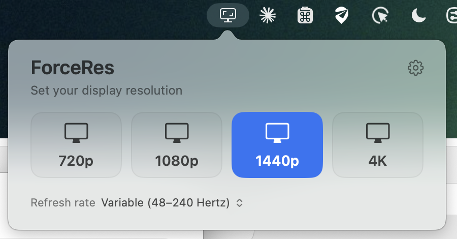

# ForceRes

A menu bar app for setting a Mac display to 720p, 1080p, 1440p or 4K.



ForceRes is in beta. Please report problems in [Issues](../../issues).

## Install

Download the latest zip from [Releases](../../releases), unzip it, and move ForceRes to Applications.

Requires macOS 15 or later on Apple silicon.

## Usage

Click the menu bar icon and choose a size. Click Keep to confirm the change. Otherwise the display reverts after 15 seconds.

- **Default** returns the display to the size it had before ForceRes changed it. It appears as a tile when the display is off its default size and none of the four sizes matches it, and is always in the gear menu.
- **Refresh rate** lists the rates the display supports at the current size.
- **Gear menu** switches the sizes between 16:9 and 16:10, turns on Low Resolution (1x), and sets Launch at Login.
- **Multiple displays:** the panel controls the display whose menu bar you clicked, and a picker switches between them.

Kept sizes are reapplied when ForceRes launches. Quitting returns every display to its original size.

Sizes a display cannot show are dimmed, and hovering one shows the reason. A MacBook's built-in screen reaches extra sizes by mirroring a virtual display that runs at the rate chosen in the refresh rate control. 16:9 sizes appear letterboxed on its 16:10 screen.

## Building

Requires Xcode.

```sh
swift build
swift test
Scripts/run-checks.sh
Scripts/build-app.sh
```

`build-app.sh` writes a signed `dist/ForceRes.app`. Before changing `Sources/ForceResDisplay`, read [docs/RESEARCH.md](docs/RESEARCH.md), which explains how display modes work on Apple silicon and which approaches are unsafe.
