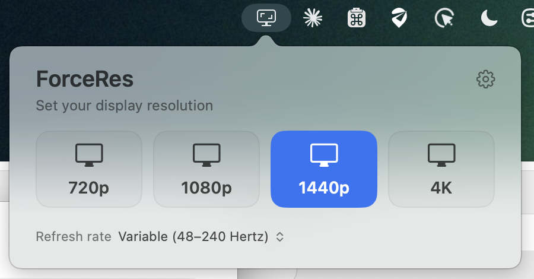

# ForceRes

A menu bar app that sets any Mac display to 720p, 1080p, 1440p or 4K.

ForceRes is in beta. Bug reports are welcome in [Issues](../../issues).



## Install

Download the latest zip from [Releases](../../releases), unzip it and move ForceRes to Applications.

Requires macOS 15 or later on Apple silicon.

## Use

- Click the menu bar icon and choose a size. Click Keep to confirm, or the display goes back after 15 seconds.
- Default Resolution returns the display to the size it had before ForceRes changed it.
- The refresh rate control lists the rates the display supports at the current size.
- The gear menu switches the sizes between 16:9 and 16:10 and turns on Low Resolution (1x).
- With several displays, the panel controls the display whose menu bar you clicked.
- Quitting ForceRes returns every display to its original size.

Sizes a display cannot show are greyed out with the reason. A MacBook's built-in screen gets its extra sizes through a virtual display that the screen mirrors, so 16:9 sizes show with black bars on its 16:10 screen.

## Build

Requires Xcode.

```sh
swift build
swift test
Scripts/run-checks.sh
Scripts/build-app.sh
```

[docs/RESEARCH.md](docs/RESEARCH.md) covers how display modes work on Apple silicon and which approaches are unsafe. Read it before changing `Sources/ForceResDisplay`.
